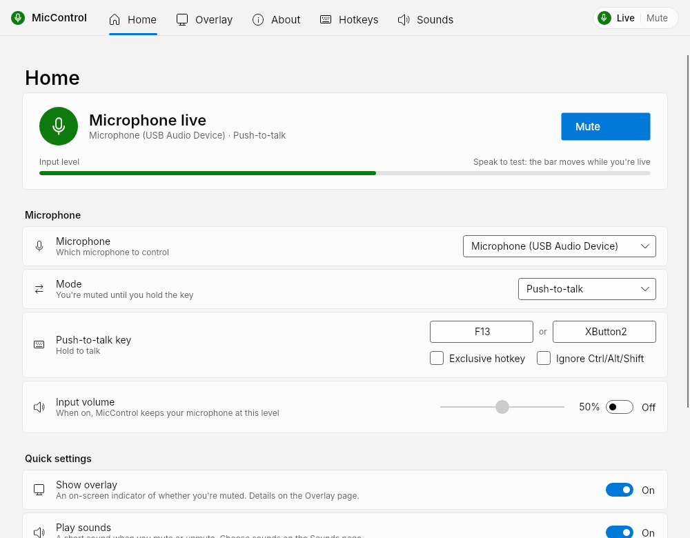
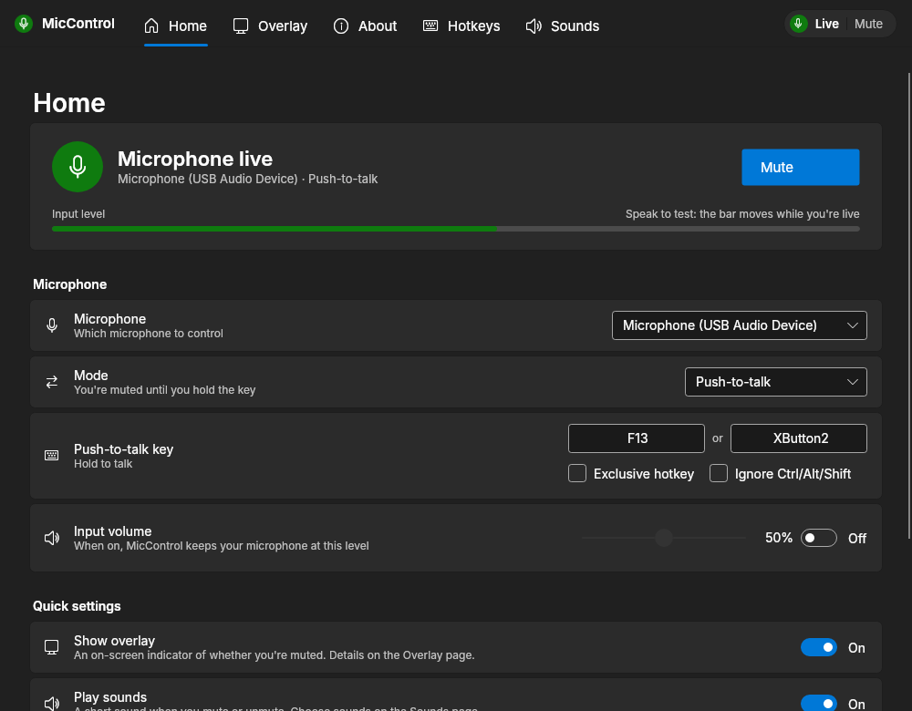
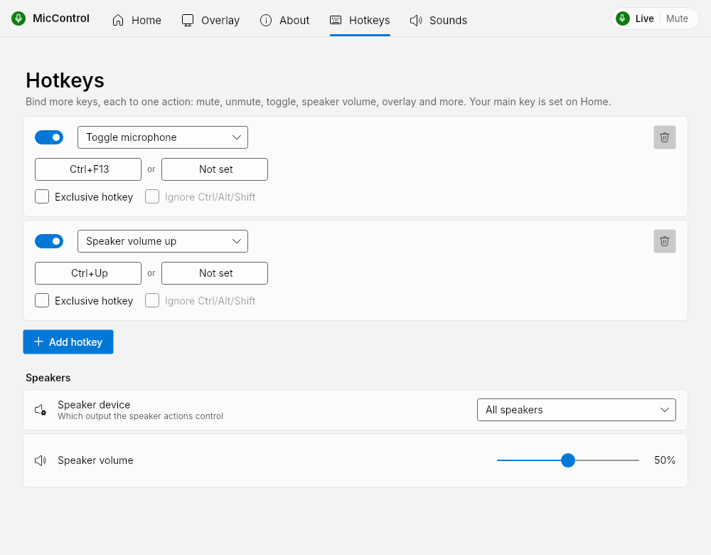
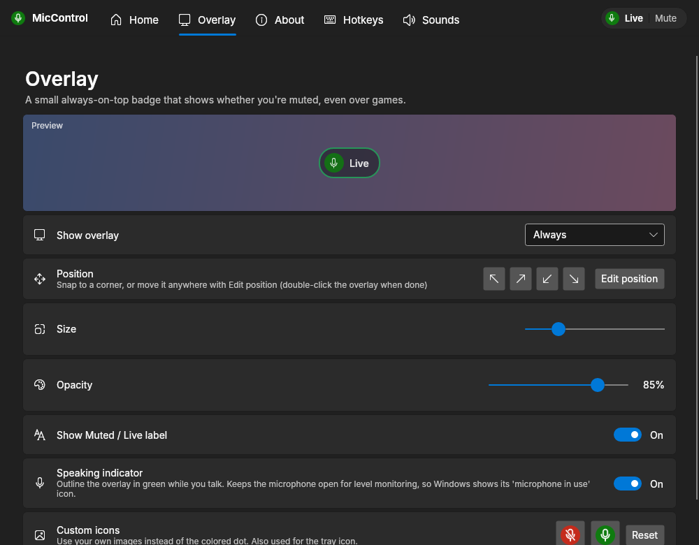
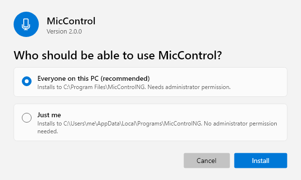

# MicControl

**MicControl** mutes and unmutes your microphone system-wide with a hotkey, with an always-on-top overlay, sounds and a tray icon. It works with every app that uses the microphone: Discord, Teams, Zoom, games and more.

Built on .NET 10 and Avalonia, with Linux (KDE Plasma 6 on Wayland) planned next. Inspired by [MicSwitch](https://github.com/iXab3r/MicSwitch) by Xab3r; MicSwitch 1.x settings are imported automatically.

## Screenshots
| Light | Dark |
| --- | --- |
|  |  |
|  |  |

| The overlay | Setup |
| --- | --- |
|   |  |

## Features
- **Three modes:** push-to-talk (the default), toggle, and push-to-mute
- **Hotkeys that work everywhere,** including in elevated games: keyboard keys, combinations and mouse side buttons, with an optional alternative key and an "exclusive" option that hides the key from other apps
- **Custom hotkeys** (optional, under About → Advanced, then on the Hotkeys page) for mute, unmute, toggle, push-to-talk, speaker mute and volume, and showing or hiding the overlay
- **One microphone or all of them** at once, handy for streamers with several inputs
- **Overlay:** a small always-on-top badge that shows Live or Muted, even over games. Snap it to any corner of any monitor or drag it anywhere; show it always, only when muted or only when live; adjust size and opacity; optional speaking indicator; your own icons
- **Sounds** when the microphone switches on and off: subtle built-in cues, or (with Custom sounds under About → Advanced) your own audio files, volume and playback device
- **Lives in the tray:** starts with Windows, stays out of the way, a click on the tray icon opens the window, and right-click has quick controls
- **Light and dark,** following Windows and its accent colour
- **Installs for everyone or just you** (no admin needed for just you), and **updates itself** from GitHub Releases, verified before it runs
- **MicSwitch 1.x settings are imported** automatically on first start

## Install
Download `MicControl-Setup-<version>.exe` from [Releases](https://github.com/ChaoticHolon/MicControl/releases) and choose **Everyone on this PC** (Program Files, needs admin) or **Just me** (your own Programs folder, no admin). Settings stay in your own `%APPDATA%\MicControl` either way. Windows SmartScreen may warn because the setup isn't code-signed: choose **More info → Run anyway**. For unattended installs: `MicControl-Setup-<version>.exe --install --silent --scope=all` (or `--scope=user`); uninstall with `MicControl.exe --uninstall --silent`.

## How to build

Requirements: Windows 10 (version 2004 or later) and the [.NET 10 SDK](https://dotnet.microsoft.com/download/dotnet/10.0) (included with Visual Studio 2026's ".NET desktop development" workload).

```
git clone https://github.com/ChaoticHolon/MicControl.git
cd MicControl/Sources
dotnet build MicControl.slnx
dotnet test --project MicControl.Tests
dotnet run --project MicControl
```

In Visual Studio, open `Sources\MicControl.slnx`, set **MicControl** as the startup project and run. Start Visual Studio as administrator: the app requests elevation so hotkeys keep working in elevated games.

To build the setup, run `installer\build.ps1` from the repository root. It writes `artifacts\MicControl-Setup-<version>.exe`, which is the app itself published as one file: started under that name it shows the installer.

Releases are automated: pushing a `vMAJOR.MINOR.PATCH` tag (e.g. `v1.0.0`) on a commit in `master` builds the setup in GitHub Actions and publishes it to [Releases](https://github.com/ChaoticHolon/MicControl/releases) with a `SHA512SUMS` file (`sha512sum -c SHA512SUMS` checks a download). The tag must match `<Version>` in `Sources\Directory.Build.props`.

The UI is built with [Avalonia](https://avaloniaui.net) so it can run on Linux soon (KDE Plasma 6 on Wayland is the planned first target). The tests, including headless UI tests, run on Windows and Linux.

### Project layout
| Project | Contents |
| --- | --- |
| `MicControl.Core` | Platform-independent logic and contracts: settings model and JSON storage, MicSwitch 1.x import, hotkey text format, mute rules, notification sound library, and the `MicControl.Platform` interfaces each OS implements |
| `MicControl.UI` | Avalonia 12 UI (Fluent theme, light/dark): views, view models (CommunityToolkit.Mvvm), tray icon, app composition |
| `MicControl.Windows` | Windows implementations: Core Audio mute/volume (NAudio), low-level keyboard/mouse hooks, WASAPI sound playback, start with Windows, overlay click-through |
| `MicControl` | Windows executable (`MicControl.exe`): wires the UI to the Windows services; single instance; updates through the installer |
| `MicControl.Tests` | xUnit v3 tests: core logic plus headless UI tests against fake platform services |

### Settings
Settings are stored in `%APPDATA%\MicControl\settings.json`, logs in `%APPDATA%\MicControl\logs`. On first start, MicControl imports a MicSwitch 1.x `%APPDATA%\MicSwitch\release\config.cfg`, with its custom icon and sounds (MicSwitch's beeps become MicControl's own cues). The mode and startup state start from MicControl's defaults (push-to-talk, muted), and setup still runs so you can review what was imported. A MicSwitch autostart entry is taken over by MicControl only when the MicSwitch program it starts has been removed; an installed MicSwitch keeps its own.

### Credits
Inspired by [MicSwitch](https://github.com/iXab3r/MicSwitch) by Xab3r. Icons from Microsoft's [Fluent UI System Icons](https://github.com/microsoft/fluentui-system-icons) (MIT licence, bundled in `Sources/MicControl.UI/Assets/Fonts`).
