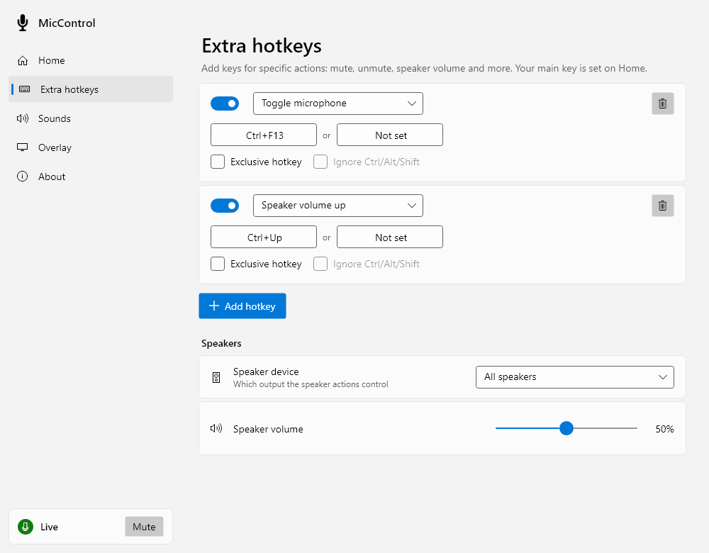
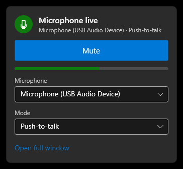

# MicControlNG

**MicControl Next Generation** (MicControlNG): mute and unmute your microphone system-wide with a hotkey, with an always-on-top overlay, sounds and a tray icon. It works with every app that uses the microphone: Discord, Teams, Zoom, games and more.

MicControl is the successor to [MicSwitch](https://github.com/iXab3r/MicSwitch) by Xab3r, rebuilt on .NET 10 and Avalonia, with explicit plans to eventually release it cross-platform as the original developer intended. MicSwitch settings are imported automatically.

## Screenshots
| Light | Dark |
| --- | --- |
|  |  |
|  |  |

| Quick controls from the tray | The overlay | Setup |
| --- | --- | --- |
|  |   |  |

## Features
- **Three modes:** push-to-talk (the default), toggle, and push-to-mute
- **Hotkeys that work everywhere,** including in elevated games: keyboard keys, combinations and mouse side buttons, with an optional alternative key and an "exclusive" option that hides the key from other apps
- **Extra hotkeys** for mute, unmute, toggle, push-to-talk, speaker mute and volume, and showing or hiding the overlay
- **One microphone or all of them** at once, handy for streamers with several inputs
- **Overlay:** a small always-on-top badge that shows Live or Muted, even over games. Snap it to any corner of any monitor or drag it anywhere; show it always, only when muted or only when live; adjust size and opacity; optional speaking indicator; your own icons
- **Sounds** when the microphone switches on and off: subtle built-in cues, or your own audio files
- **Lives in the tray:** starts with Windows, stays out of the way, and a click on the tray icon opens quick controls
- **Light and dark,** following Windows and its accent colour
- **Installs for everyone or just you** (no admin needed for just you), and **updates itself** from GitHub Releases, verified before it runs
- **MicSwitch settings are imported** automatically on first start

## Install
Download `MicControlNG-Setup-<version>.exe` from [Releases](https://github.com/ChaoticHolon/MicControlNG/releases) and choose **Everyone on this PC** (Program Files, needs admin) or **Just me** (your own Programs folder, no admin). Settings stay in your own `%APPDATA%\MicControlNG` either way. Windows SmartScreen may warn because the setup isn't code-signed: choose **More info → Run anyway**. For unattended installs: `MicControlNG-Setup-<version>.exe --install --silent --scope=all` (or `--scope=user`); uninstall with `MicControlNG.exe --uninstall --silent`.

## How to build

Requirements: Windows 10 (version 2004 or later) and the [.NET 10 SDK](https://dotnet.microsoft.com/download/dotnet/10.0) (included with Visual Studio 2026's ".NET desktop development" workload).

```
git clone https://github.com/ChaoticHolon/MicControlNG.git
cd MicControlNG/Sources
dotnet build MicControlNG.slnx
dotnet test --project MicControlNG.Tests
dotnet run --project MicControlNG
```

In Visual Studio, open `Sources\MicControlNG.slnx`, set **MicControlNG** as the startup project and run. Start Visual Studio as administrator: the app requests elevation so hotkeys keep working in elevated games.

To build the setup, run `installer\build.ps1` from the repository root. It writes `artifacts\MicControlNG-Setup-<version>.exe`, which is the app itself published as one file: started under that name it shows the installer.

Releases are automated: pushing a `vMAJOR.MINOR.PATCH` tag (e.g. `v2.1.0`) on a commit in `master` builds the setup in GitHub Actions and publishes it to [Releases](https://github.com/ChaoticHolon/MicControlNG/releases) with a `SHA256SUMS` file. The tag must match `<Version>` in `Sources\Directory.Build.props`.

The UI is built with [Avalonia](https://avaloniaui.net) so it can run on Linux soon (KDE Plasma 6 on Wayland is the planned first target). The tests, including headless UI tests, run on Windows and Linux.

### Project layout
| Project | Contents |
| --- | --- |
| `MicControlNG.Core` | Platform-independent logic and contracts: settings model and JSON storage, MicSwitch import, hotkey text format, mute rules, notification sound library, and the `MicControlNG.Platform` interfaces each OS implements |
| `MicControlNG.UI` | Avalonia 12 UI (Fluent theme, light/dark): views, view models (CommunityToolkit.Mvvm), tray icon, app composition |
| `MicControlNG.Windows` | Windows implementations: Core Audio mute/volume (NAudio), low-level keyboard/mouse hooks, WASAPI sound playback, start with Windows, overlay click-through |
| `MicControlNG` | Windows executable (`MicControlNG.exe`): wires the UI to the Windows services; single instance; updates through the installer |
| `MicControlNG.Tests` | xUnit v3 tests: core logic plus headless UI tests against fake platform services |

### Settings
Settings are stored in `%APPDATA%\MicControlNG\settings.json`, logs in `%APPDATA%\MicControlNG\logs`. On first start, MicControl imports from `%APPDATA%\MicSwitch`: settings, custom icons and sounds from recent builds, or a MicSwitch 1.x `release\config.cfg`. A MicSwitch autostart entry is taken over by MicControl only when the MicSwitch program it starts has been removed; an installed MicSwitch keeps its own.
